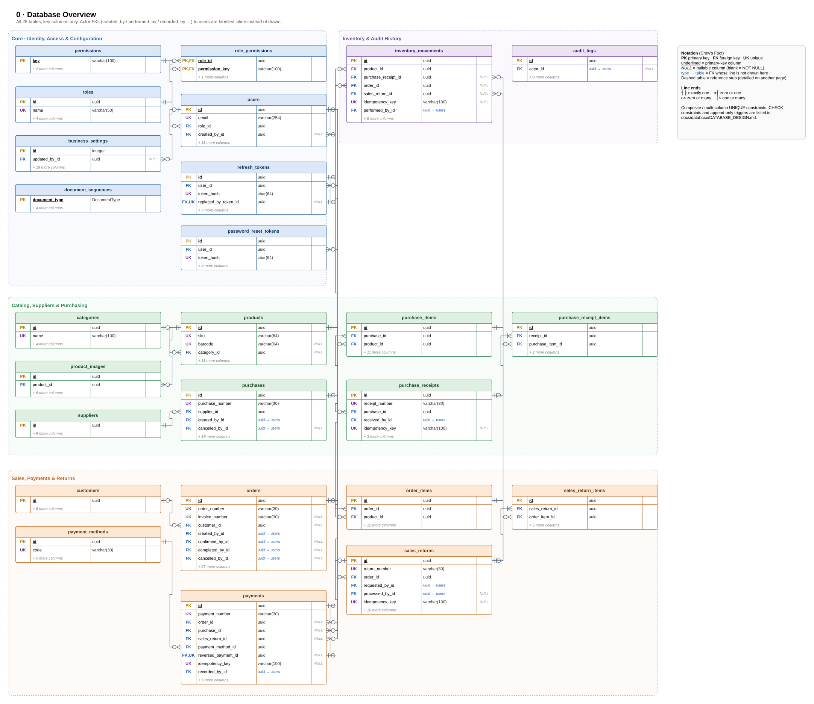

# Mini Inventory & Order Management System

A portfolio-grade inventory and order management system for a small/medium business: purchasing and goods receipts, an append-only stock ledger, customer orders with invoices, payments and refunds, sales returns, reports, RBAC and audit logs — built with a focus on data integrity under concurrency.

> **Status:** All 10 phases (Phases 0–10) complete & verified — MVP ready for production deployment. See [docs/FINAL_REVIEW.md](docs/FINAL_REVIEW.md) and [PROJECT_PROGRESS.md](PROJECT_PROGRESS.md).

> **Contributors and AI agents:** read [AGENTS.md](AGENTS.md) first — working rules, owner decisions, conventions and setup. The original brief is in [docs/PROJECT_BRIEF.md](docs/PROJECT_BRIEF.md).

## Stack

| Layer | Technology |
|-------|-----------|
| Backend | Node.js 22, Express 5, TypeScript 5.9, Prisma 6, PostgreSQL 16, Zod 4, bcrypt, pino |
| Frontend | Next.js 16 (`16.4.6`, App Router BFF, Server Components/Actions), React 19, Tailwind CSS 4, shadcn/ui |
| Testing | Vitest 4, Supertest (real PostgreSQL), Testing Library, Playwright |
| Tooling | Docker / Multi-stage Dockerfiles, Docker Compose, GitHub Actions, OpenAPI 3 + Swagger UI |

## Quick start (local development)

Prerequisites: Node.js 22+, Docker.

```bash
# 1. Infrastructure: PostgreSQL 16 (host port 5433, databases inventory + inventory_test) and Mailpit
docker compose up -d

# 2. Backend
cd backend
cp .env.example .env          # defaults work with docker compose
npm ci
npx prisma migrate deploy     # apply migrations
npm run db:seed               # permissions, roles, settings, payment methods, initial admin
npm run dev                   # http://localhost:4000

# 3. Frontend (in a separate terminal)
cd frontend
cp .env.example .env.local    # API_BASE_URL=http://localhost:4000/api/v1
npm ci
npm run dev                   # http://localhost:3000
```

- API docs (Swagger UI): http://localhost:4000/api/docs
- Health: http://localhost:4000/api/v1/health/ready
- Mailpit (password-reset emails): http://localhost:8025
- Initial admin: `admin@example.com` / `ChangeMe123!` (from `SEED_ADMIN_*` in `.env` — change it after first login)

```bash
curl -s -X POST localhost:4000/api/v1/auth/login \
  -H 'content-type: application/json' \
  -d '{"email":"admin@example.com","password":"ChangeMe123!"}'
```

## Backend scripts

| Command | Purpose |
|---------|---------|
| `npm run dev` | Start with reload (tsx) |
| `npm run build` / `npm start` | Compile to `dist/` / run compiled server |
| `npm test` | Unit + integration tests (integration needs the compose PostgreSQL) |
| `npm run test:unit` / `npm run test:integration` | Single suite |
| `npm run lint` / `npm run typecheck` | ESLint / tsc |
| `npm run db:migrate` | Create & apply a new migration (development) |
| `npm run db:deploy` | Apply migrations (CI / production) |
| `npm run db:seed` | Idempotent base seed + initial admin |

## Frontend scripts

| Command | Purpose |
|---------|---------|
| `npm run dev` | Start Next.js dev server (`http://localhost:3000`) |
| `npm run build` / `npm start` | Production build / start Next.js server |
| `npm test` | Run Vitest unit & component tests |
| `npm run test:e2e` | Run Playwright end-to-end suite (requires running backend & frontend) |
| `npm run lint` / `npm run typecheck` | ESLint / tsc |

## Production deployment

See [docs/deployment/DEPLOYMENT.md](docs/deployment/DEPLOYMENT.md) for environment setup, reverse proxy / TLS configuration, least-privilege database role hardening (`scripts/db/harden-app-role.sql`), and backup/restore scripts (`scripts/backup/`).

```bash
cp .env.prod.example .env.prod    # fill real secrets & domain URLs
docker compose --env-file .env.prod -f docker-compose.prod.yml up -d --build
```

## Repository layout

```
backend/                 Express API + Dockerfile — src/{config,common,modules,database}, prisma/, tests/
frontend/                Next.js BFF + Dockerfile — src/{app,components,lib}, tests/, e2e/
scripts/                 erd/ (schema → ERD.drawio), db/ (harden-app-role.sql), backup/ (backup.sh, restore.sh)
docs/                    requirements, architecture, database, api, security, testing, deployment, diagrams (ERD)
docker-compose.yml       local PostgreSQL + Mailpit (+ optional `fullstack` profile)
docker-compose.prod.yml  production PostgreSQL, migrate, backend, frontend stack
.env.prod.example        production environment template
```

## Documentation

| Topic | Document |
|-------|----------|
| Overview & scope | [docs/requirements/PROJECT_OVERVIEW.md](docs/requirements/PROJECT_OVERVIEW.md) |
| Requirements | [Functional](docs/requirements/FUNCTIONAL_REQUIREMENTS.md) · [Non-functional](docs/requirements/NON_FUNCTIONAL_REQUIREMENTS.md) · [Business rules](docs/requirements/BUSINESS_RULES.md) |
| Architecture | [System architecture](docs/architecture/SYSTEM_ARCHITECTURE.md) · [Technical decisions](docs/architecture/TECHNICAL_DECISIONS.md) |
| Database | [Design](docs/database/DATABASE_DESIGN.md) · ERD: [draw.io source](docs/diagrams/ERD.drawio), [overview PNG](docs/diagrams/ERD.png) |
| API | [Design & conventions](docs/api/API_DESIGN.md) · [OpenAPI](docs/api/openapi.yaml) |
| Security | [docs/security/SECURITY.md](docs/security/SECURITY.md) |
| Testing | [docs/testing/TESTING_STRATEGY.md](docs/testing/TESTING_STRATEGY.md) |
| Deployment | [docs/deployment/DEPLOYMENT.md](docs/deployment/DEPLOYMENT.md) |
| Final review | [Phase 10 completion checklist](docs/FINAL_REVIEW.md) · [Progress log](PROJECT_PROGRESS.md) |


